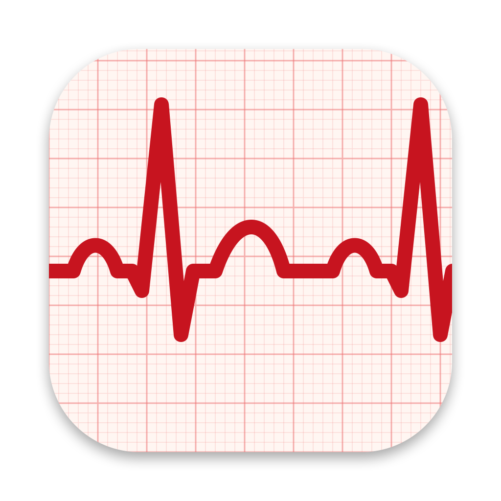

<p align="center"></p>

# ECG Menu

Petite application macOS de la barre des menus pour rédiger en quelques clics un compte rendu d'ECG, pensée pour la médecine générale.

## Fonctionnalités

- **Axe, rythme et FC** : axe normal présélectionné, RSR ou FA, BAV (1, Mobitz I, Mobitz II, 2:1, 3).
- **Ondes** : onde Q significative (avec dérivations), S1Q3, onde delta.
- **QRS** : fins ou blocs de branche (BBDi, BBGi, BBD, BBG).
- **Segment ST** : sus- ou sous-décalage, avec dérivations et territoire déduit automatiquement.
- **Onde T** : négatives, biphasiques, amples et pointues ; **onde U** ; **ESA / ESV**.
- **Calculs à partir des mesures en mm** (papier à 25 ou 50 mm/s) :
  - QTc de Framingham à partir du QT et du RR ;
  - FC à partir du RR ;
  - indice de Sokolow-Lyon (SV1 + RV5/V6).
- **Aide au survol** : chaque choix affiche un tracé type et un rappel des critères.
- **Compte rendu** généré dans un ordre fixe, modifiable avant d'être copié (⇧⌘C).

## Installation

1. Télécharger `ECGMenu.dmg` depuis la page [Releases](../../releases).
2. Glisser **ECGMenu** dans le dossier Applications.
3. Premier lancement : clic droit sur l'app → **Ouvrir**, puis confirmer.
   L'app n'est pas signée par un compte développeur Apple, macOS demande donc une confirmation la première fois.
4. Une icône QRS apparaît dans la barre des menus :
   - clic gauche : compte rendu ;
   - clic droit : « Ouvrir au démarrage de l'ordinateur » ou « Quitter ».

Nécessite macOS 14 (Sonoma) ou plus récent.

## Compiler depuis les sources

Avec Xcode (ou ses outils en ligne de commande) installé :

```bash
./build.sh        # crée ECGMenu.app
./build.sh dmg    # crée aussi ECGMenu.dmg
```

L'icône est générée par `tools/make_icon.swift`.

## Avertissement

Outil d'aide à la rédaction uniquement. Il ne pose aucun diagnostic : le compte rendu doit toujours être relu et validé par un médecin.
